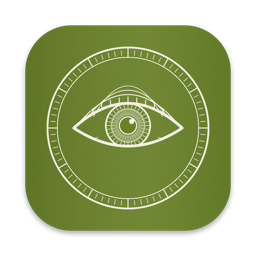
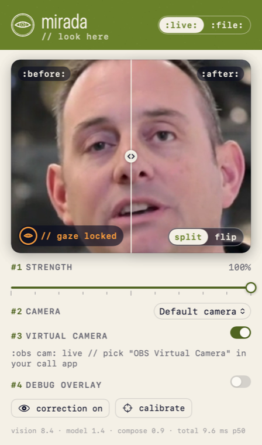
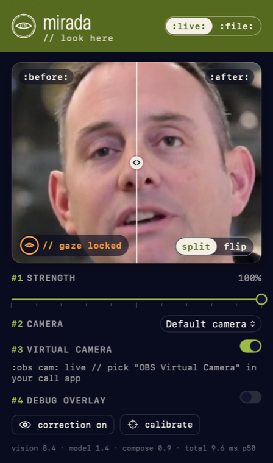
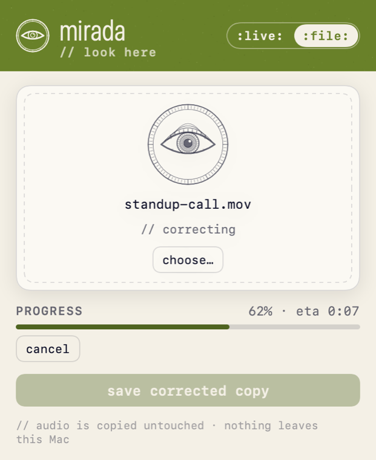
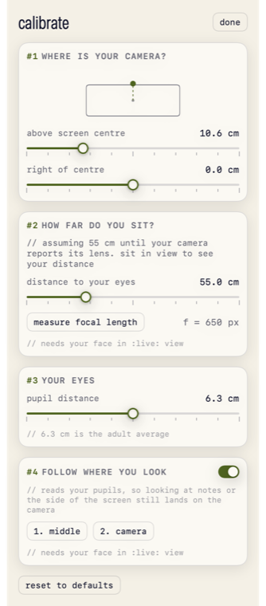
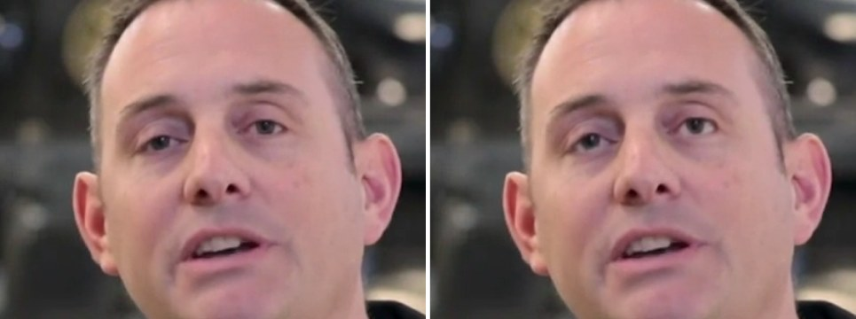
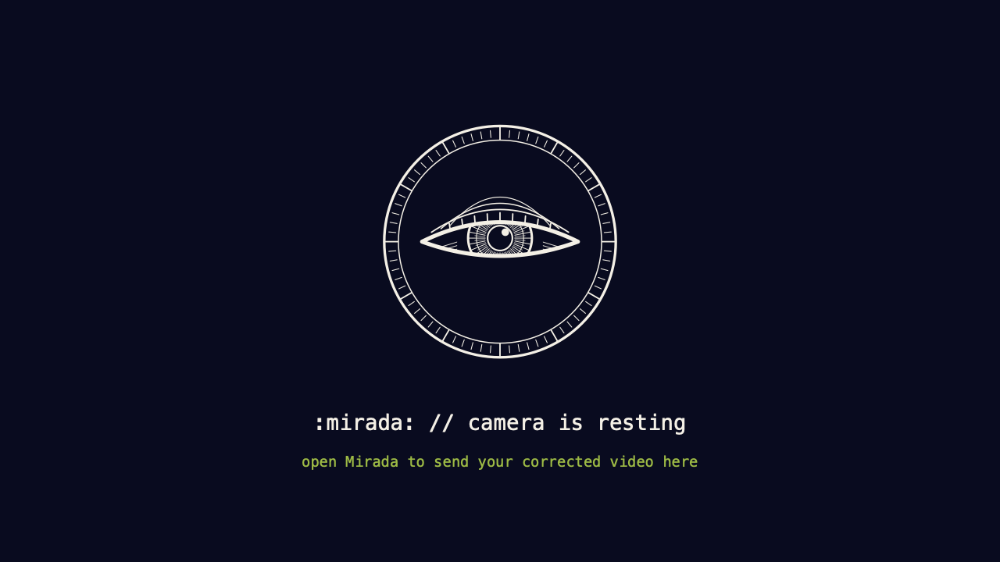
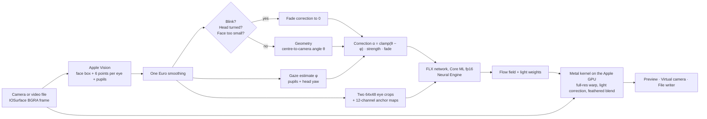
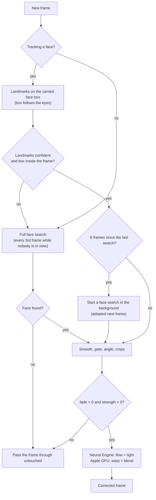

<p align="center"></p>

<h1 align="center">Mirada</h1>

<p align="center"><b>Look at the camera, on every call. Real-time gaze correction that runs entirely on your Mac's Apple GPU and Neural Engine.</b></p>

<p align="center">
<a href="https://github.com/jc-gt3rs/Mirada/releases/latest">Download v0.1.0 (.dmg)</a> ·
<a href="#how-it-works">How it works</a> ·
<a href="#the-maths">The maths</a> ·
<a href="#build-from-source">Build from source</a>
</p>

Mirada is a small Mac app and command-line tool that turns your eyes toward the lens, live in video calls or in recorded videos. It finds your eyes with Apple Vision, predicts a warp with a small neural network on the **Neural Engine**, and redraws your eyes at full resolution with a **Metal compute kernel on the Apple GPU**. Every frame stays on your Mac: no cloud, no uploads, no network calls.

| Live, light | Live, dark | File | Calibrate |
|---|---|---|---|
|  |  |  |  |

<p align="center"><br><sub>Before and after, full strength, 18° upward. Source: a public-domain CBP video (see THIRD_PARTY_NOTICES.md).</sub></p>

## Built for Apple silicon

Mirada is designed around the Mac's unified memory. A camera frame is written once into an IOSurface and every stage reads that same memory:

| Stage | Runs on | Time per frame (M2 Max, 1280x720) |
|---|---|---|
| Face and eye landmarks (Apple Vision) | Neural Engine / GPU | 8 ms p50 (face search moved off the frame path) |
| FLX gaze-warping network, both eyes (Core ML, fp16) | **Neural Engine** | 0.4 ms (1.4 ms with crop sampling) |
| Full-resolution eye warp, light correction, feathered blend (Metal compute kernel) | **Apple GPU** | 0.9 ms |
| Preview (CALayer) and virtual camera (CoreMediaIO) | GPU / zero-copy IOSurface | - |

- **Zero copy:** camera buffers, Vision, Metal textures (`CVMetalTextureCache`), the preview layer and the virtual camera all share IOSurfaces. Only the two 64×48 eye crops are read on the CPU.
- **Full-resolution warp on the GPU:** the network predicts a flow field for a 64×48 crop, but the Metal kernel applies it to the original pixels, so your eyes keep their native detail instead of being upscaled from 64×48.
- **Measured:** 29.8 fps sustained, about 21.5 ms per frame live from the FaceTime camera with 0.55% of frames dropped, memory flat at about 53 MB over 30 minutes, and files processed at 7.8x real time at 1080p.

## What it does, and what it doesn't

- **Live.** Your webcam goes through Mirada and comes out as a virtual camera that Zoom, Meet, Teams, FaceTime and Photo Booth can select.
- **File.** A video or photo goes in and a corrected copy comes out. Audio is copied bit for bit; frame timing, rotation and color tags are kept.
- **Follows where you look.** Mirada reads your pupils to see where on the screen you are looking (notes on the left, a chat on the right) and turns your eyes from there to the camera. Look straight at the camera and it does nothing.
- **Knows your camera.** It reads the lens focal length your camera reports with every frame, so it knows your distance without calibration.
- **Never stares.** It fades itself out when you blink or turn your head more than about 25°, and leaves frames untouched when no face is visible.
- **Keeps running.** Close the window and correction (and the virtual camera) carries on; the **Correction** menu and ⌘0 bring it back.

Honest limits:

- **Small corrections look natural; large ones don't.** Up to about 15° your eyes look like yours. Past 20–25° the iris can smear or bulge; lower the strength if that bothers you.
- **The model is small and from 2019.** FLX was trained on 37 volunteers looking straight ahead, all from one population. Eye shapes, skin tones, lighting and head poses it never saw may work less well. Glasses work; strong reflections can wobble.
- **Vertical gaze is the weaker estimate.** Eyelids move with the eye and hide most of its vertical travel. The "look at the camera" calibration step compensates.
- **It will not match NVIDIA Broadcast's Maxine Eye Contact** or other large modern models. Think of it as a tasteful nudge.

## Install

1. Download `Mirada-0.1.0.dmg` from [Releases](https://github.com/jc-gt3rs/Mirada/releases/latest) and drag **Mirada** to Applications.
2. v0.1.0 is not notarized (that needs a paid Apple Developer account). The first time you open it, macOS blocks it: go to **System Settings > Privacy & Security** and click **Open Anyway**. On macOS 14 you can instead right-click Mirada and choose **Open**.
3. Allow camera access when asked.

Requirements: macOS 14 or later on Apple silicon (M1 or newer).

The command-line tool is a separate download, `mirada-cli-0.1.0-macos-arm64.zip`. Unzip it and keep `mirada` and `Mirada_MiradaKit.bundle` together (the bundle holds the model). If macOS blocks the binary, run `xattr -dr com.apple.quarantine mirada-0.1.0` once.

### Using it as a camera in other apps

macOS doesn't let one app change what another app gets from your FaceTime camera, so each app must **pick the virtual camera**: Photo Booth's **Camera** menu, FaceTime's **Video** menu, or the camera setting in Zoom, Meet and Teams.

- **With a free Apple ID (v0.1.0):** Mirada publishes through **OBS Virtual Camera**. Install [OBS Studio](https://obsproject.com), click **Start Virtual Camera** once, approve the extension in **System Settings > General > Login Items & Extensions > Camera Extensions**, then quit OBS. In your call app, choose **OBS Virtual Camera**. The name is OBS's and can't be changed; don't start OBS's own virtual camera while Mirada is sending.
- **With a paid Apple Developer team:** Mirada ships its own CoreMediaIO camera extension, **Mirada Camera** (with an engraved "camera is resting" card when Mirada isn't running). Build with `MIRADA_PAID_TEAM = YES` (see [Build from source](#build-from-source)), click **install** under **#3 virtual camera**, and approve it in System Settings. This path builds and signs, but has not been activated yet.

<p align="center"></p>

### Calibration (optional)

Open **calibrate** (⌘K):

1. **Where is your camera?** Centimetres above and to the right of the screen's centre. On a MacBook this starts from the built-in screen's physical size.
2. **How far do you sit?** Automatic when your camera reports its lens (the FaceTime camera does). Otherwise enter your distance and press **measure focal length**.
3. **Your eyes.** Pupil distance; 6.3 cm is the adult average.
4. **Follow where you look.** Look at the middle of your screen and press **1. middle**, then look at the lens and press **2. camera**.

### Keyboard

| Keys | Action |
|---|---|
| ⌘G | Correction on or off |
| ⌘D | Debug overlay: face box, eye points, model crops, correction arrow and a live readout, drawn into the video everywhere it goes |
| ⌘1 / ⌘2 | Live / File |
| ⌘B | Show the original in flip mode |
| ⌘K | Calibrate |
| ⌘⇧R | "I'm looking at the middle of the screen" |
| ⌘0 | Show the window again |
| ⌘S | Save the corrected copy (File) |

Every control has a VoiceOver label; the sliders and the before/after divider can be adjusted with VoiceOver's increment and decrement. The lock animation respects Reduce Motion.

## How it works



What happens to each frame:



## The maths

All angles follow the model's convention: positive horizontal turns the iris toward the image's right, positive vertical turns it up. Coordinates are centimetres with the origin at the centre of the screen, $+x$ right, $+y$ down, and $-z$ toward you.

### 1. Where your eyes are

Let $\mathbf{e}_L, \mathbf{e}_R$ be the eye centres (midpoints of each eye's corners) in pixels, $W\times H$ the frame size, $f$ the focal length in pixels, $\mathrm{IPD}$ your interpupillary distance (cm), and $\mathbf{c} = (c_x, c_y, c_z)$ the camera position.

$$d = \lVert \mathbf{e}_L - \mathbf{e}_R \rVert, \qquad z = -\frac{f \cdot \mathrm{IPD}}{d}$$

$$x = -|z|\,\frac{e_{L,x} + e_{R,x} - W}{2f} + c_x, \qquad y = |z|\,\frac{e_{L,y} + e_{R,y} - H}{2f} + c_y$$

### 2. Focal length, automatically

Cameras report a 35 mm-equivalent focal length $f_{35}$ with every frame. Scaling by the diagonal of the 35 mm frame (36 × 24 mm):

$$f = f_{35} \cdot \frac{\sqrt{W^2 + H^2}}{\sqrt{36^2 + 24^2}}$$

The FaceTime HD camera reports $f_{35} = 27.7$ mm, so $f \approx 941$ px at 1280×720. Without lens metadata (most files), Mirada assumes you sit 55 cm away: $f = \tilde d \cdot 55 / \mathrm{IPD}$ with $\tilde d$ the median eye distance. A measured value overrides both.

### 3. Screen-centre-to-camera angle

The angle from looking at the screen centre to looking at the camera (Hsu et al. 2019):

$$\theta_v = \arctan\frac{-y}{-z} + \arctan\frac{y - c_y}{c_z - z}, \qquad \theta_h = \arctan\frac{-x}{-z} + \arctan\frac{x - c_x}{c_z - z}$$

### 4. Where you are actually looking

For each eye, with corners $\mathbf{a}$ (image-left) and $\mathbf{b}$, eye width $w = \lVert \mathbf{b} - \mathbf{a} \rVert$, axis $\hat{\mathbf{u}} = (\mathbf{b} - \mathbf{a})/w$, normal $\hat{\mathbf{n}} \perp \hat{\mathbf{u}}$, midpoint $\mathbf{m}$ and pupil $\mathbf{p}$:

$$u = \frac{(\mathbf{p} - \mathbf{m}) \cdot \hat{\mathbf{u}}}{w}, \qquad v = \frac{(\mathbf{p} - \mathbf{m}) \cdot \hat{\mathbf{n}}}{w}$$

Averaging both eyes cancels each eye's mirror-image bias. With head yaw $\psi$ and the calibrated middle $(u_0, v_0, \psi_0)$ (or a 90 s running median until you calibrate), the gaze deviation from the middle of the screen is:

$$\varphi_h = (\psi - \psi_0) + g_h\,(\bar u - u_0), \qquad \varphi_v = -g_v\,(\bar v - v_0)\cdot\tau(\varphi_h)$$

$$\tau(\varphi_h) = \operatorname{clamp}\!\left(1 - \frac{|\varphi_h| - 10^\circ}{20^\circ},\ 0,\ 1\right)$$

in radians, then converted to degrees and capped at ±45°. The gains default to $g_h = 4.0$ and $g_v = 7.5$. The **2. camera** calibration solves for your own $g_v$: looking at the lens must give $\varphi_v = \theta_v$, so $g_v = \theta_v / (-(\bar v - v_0))$. $\tau$ stops a corner-turned iris (whose almond-shaped socket shifts the pupil up or down) from reading as vertical gaze.

### 5. The correction sent to the model

$$\boldsymbol{\alpha} = \operatorname{clamp}\big(\boldsymbol{\theta} - \boldsymbol{\varphi}\big) \cdot s \cdot \lambda$$

clamped to the training range ($|\alpha_v| \le 30^\circ$, $|\alpha_h| \le 40^\circ$), with $s$ the strength and $\lambda$ the fade.

### 6. Eye crops and anchor maps

Exactly as the FLX training data was cut. With eye length $L = |x_{\text{outer}} - x_{\text{inner}}|$ and corner midpoint $(c_x, c_y)$:

$$\text{width} = \tfrac{3}{2}L, \qquad \text{height} = \tfrac{9}{8}L, \qquad \text{above} = \tfrac{7}{12}\cdot\tfrac{9}{8}L, \qquad \text{below} = \tfrac{5}{12}\cdot\tfrac{9}{8}L$$

The crop is resized to 64×48 (bilinear). Each of the six eye points $(x_i, y_i)$ becomes two channels of the anchor map:

$$\hat x_i = \left\lfloor (x_i - \ell)\tfrac{64}{w_c} + \tfrac12 \right\rfloor, \quad A_{2i}(r, c) = c - \hat x_i, \qquad \hat y_i = \left\lfloor (y_i - t)\tfrac{48}{h_c} + \tfrac12 \right\rfloor, \quad A_{2i+1}(r, c) = r - \hat y_i$$

### 7. The FLX network

Inputs: the RGB crop $I$ (48×64×3), the anchor map $A$ (48×64×12) and $\boldsymbol{\alpha}$. An MLP encodes $\boldsymbol{\alpha}$ into 16 channels tiled over the crop; a coarse level at half resolution and a fine level, both densely connected CNNs, predict a flow $\boldsymbol{\phi} = \tanh(\cdot)$ and light weights $\boldsymbol{\ell} = \operatorname{softmax}(\cdot)$. About 250k parameters per eye.

The warp samples the source at

$$x_s = \tfrac12\left(\phi_x + g_x + 1\right) W, \qquad g_x = -1 + \frac{2c}{W - 1}$$

(and likewise for $y$), bilinearly, and the light correction blends toward white:

$$O = \ell_1 \cdot S(x_s, y_s) + \ell_2$$

### 8. The Metal compositor (Apple GPU)

For every output pixel inside a crop, at crop-normalised position $(s, t)$, the kernel computes the model-grid position $\mathbf{m} = (64s - \tfrac12,\ 48t - \tfrac12)$. It samples $\boldsymbol{\phi}, \boldsymbol{\ell}$ bilinearly there, maps $(x_s, y_s)$ back to full-resolution frame coordinates, samples the **original** frame, and blends:

$$a = \operatorname{smoothstep}(3, 9, \min(m_x, 63 - m_x)) \cdot \operatorname{smoothstep}(3, 8, \min(m_y, 47 - m_y)) \cdot \lambda$$

$$\text{out} = (1 - a)\,\text{orig} + a\,\big(\ell_1 \cdot \text{frame}(x_s, y_s) + \ell_2\big)$$

The outer three model pixels stay original (the training loss ignored them).

### 9. Smoothing (One Euro filter)

For a signal sampled every $\Delta t$:

$$\alpha(f_c) = \frac{1}{1 + \frac{1}{2\pi f_c \Delta t}}, \qquad f_c = f_{\min} + \beta\,|\dot{\hat x}|, \qquad \hat x_k = \alpha(f_c)\,x_k + \big(1 - \alpha(f_c)\big)\,\hat x_{k-1}$$

Landmarks: $f_{\min} = 1.2$ Hz and $\beta = 0.6$, in units of eye distance (2.2–2.9x less jitter). Fade: $\beta = 0$, 2 Hz going in and 6 Hz going out, so a closing eyelid is never corrected.

### 10. Blinks and head turns

Eye aspect ratio (Soukupová and Čech 2016), with $p_1 \dots p_6$ the eye points:

$$\mathrm{EAR} = \frac{\lVert p_2 - p_6 \rVert + \lVert p_3 - p_5 \rVert}{2\,\lVert p_1 - p_4 \rVert}$$

Closed below 0.17 (open again above 0.21); looking away when $|\text{yaw}|$ or $|\text{pitch}|$ exceeds 25° (back below 20°).

## Command line

```bash
mirada run --stats
```

```bash
mirada process talk.mp4 -o talk-mirada.mp4
```

```bash
mirada doctor
```

| Command | What it does |
|---|---|
| `run` | Live correction, published to the virtual camera. `--preview`, `--stats` (per-stage p50/p95), `--debug-overlay`, `--simulate clip.mp4` (a file as the camera), `--seconds N`. |
| `process IN -o OUT` | Video or photo. `--codec h264\|hevc`, `--bitrate 8M`, `--start 1:05 --end 1:30`, `--no-audio`, `--debug-overlay`, `--force`. |
| `devices` | Lists cameras; virtual ones are marked and never used as input. |
| `calibrate` | Interactive, or `--above --right --depth --ipd --focal --measure --distance`. |
| `doctor` | Checks macOS, the GPU, the model on the Neural Engine and CPU, camera permission and the virtual cameras. |

Common flags: `--camera`, `--strength 0..1`, `--backend ane|cpu` (`cpu` runs the fp32 model, exact to the original), `--json` (machine output on stdout; messages go to stderr). Exit codes follow sysexits: `0` ok, `64` usage, `65` bad input, `66` missing input, `69` unavailable, `70` internal, `73` can't write output, `77` camera permission denied, `130` interrupted.

## Build from source

Requirements: Xcode 27, macOS 14+, Apple silicon, and [XcodeGen](https://github.com/yonaskolb/XcodeGen) (`brew install xcodegen`).

```bash
swift build -c release
```

```bash
tools/build_app.sh Release
```

The first builds the CLI (`.build/release/mirada`; keep `Mirada_MiradaKit.bundle` next to it, since it holds the model). The second builds `build/dd/Build/Products/Release/Mirada.app`, ad-hoc signed. To sign with your own team, create `Config/Local.xcconfig` (git-ignored):

```
CODE_SIGN_STYLE = Automatic
CODE_SIGN_IDENTITY = Apple Development
DEVELOPMENT_TEAM = ABCDE12345
```

Add `MIRADA_PAID_TEAM = YES` with a paid team to enable the Mirada Camera extension.

```bash
swift test
```

- **Tests.** 65 tests pin the geometry to the reference formula, the crops to OpenCV, the model to the **original TensorFlow graph** (fp32 exact to 9e-6; fp16 Neural Engine within 1.42/255 where it is composited), the GPU warp to a CPU reference, gaze following, and end-to-end file processing (timing, rotation, bit-exact audio).
- **Release.** `tools/make_release.sh 0.1.0` builds the ad-hoc signed DMG and the CLI zip into `build/release-0.1.0/`.
- **Model.** `tools/convert_flx.py` rebuilds the Core ML models from the upstream checkpoints (`tools/fetch_upstream.sh` downloads and verifies them).
- **Docs.** Every design decision and measurement is in [DECISIONS.md](DECISIONS.md); manual checks are in [TESTING.md](TESTING.md).

```
Sources/MiradaKit/   engine: Capture, Vision, Geometry, Model, Compose (Metal), FileIO, VirtualCamera, Pipeline
Sources/mirada/      command-line tool
Sources/MiradaArt/   the engraved eye mark (icon, empty states, camera card)
App/                 SwiftUI app
CameraExtension/     CoreMediaIO camera extension (Mirada Camera)
tools/               model conversion, fixtures, build script
```

## Privacy

Video never leaves your Mac and there are no network calls at runtime; the model is bundled. Settings are a small JSON file at `~/Library/Application Support/Mirada/settings.json`.

## Credits and license

Mirada is released under the [MIT License](LICENSE).

The gaze-warping model is FLX, from *Look at Me! Correcting Eye Gaze in Live Video Communication* (Chih-Fan Hsu, Yu-Shuen Wang, Chin-Laung Lei, Kuan-Ta Chen, ACM TOMM 2019). Its weights are BSD-3-Clause, © 2019 Chih-Fan Hsu, and are bundled under that license. [WangWilly/gaze-correction-cam](https://github.com/WangWilly/gaze-correction-cam) was the starting point for reading it. Full notices: [THIRD_PARTY_NOTICES.md](THIRD_PARTY_NOTICES.md).
